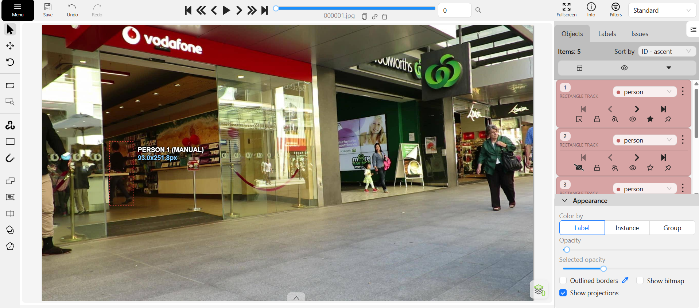
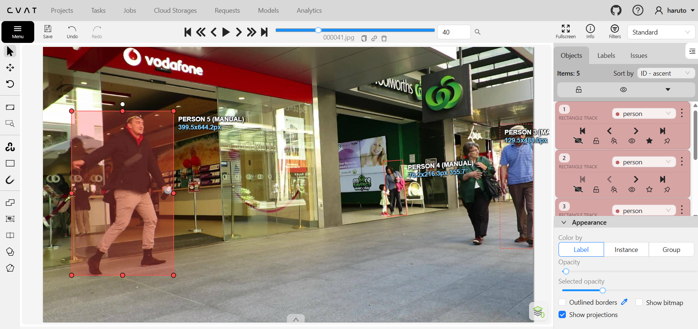
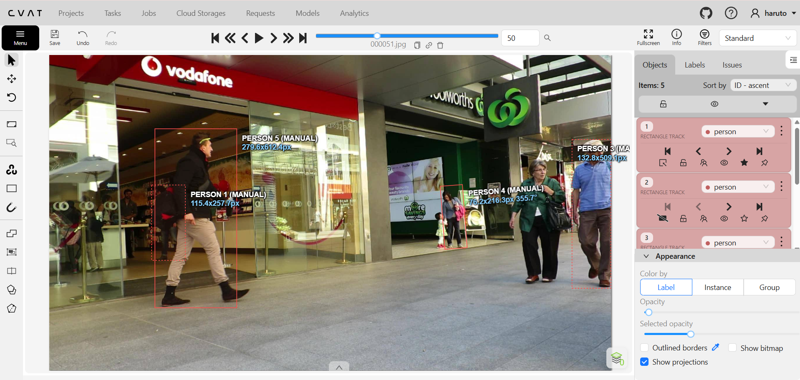

# Báo cáo cá nhân — HoVaTen-MSSV

Đổi tên file theo quy tắc `MSSV_HoTen.md`. Ví dụ: `20241234_NguyenVanAn.md`.

Đoạn video: MOT17-09, 150 frame (frame 1–150), nguồn MOTChallenge, giấy phép CC BY-NC-SA 3.0.

## 0. Thông tin học viên

- Họ tên: Nguyễn Minh Hiếu
- MSSV: 2A202603169
- Mã đề (A/B/C): C
- Email: harutoryuoma@gmail.com
- Link repository: https://github.com/harutoryuoma/K5-L2A-DAY05-NguyenMinhHieu-2A202603169-MOTTracking.git
- Giờ bắt đầu: 5h20
- Giờ kết thúc: 6h39

## 1. Xem trước đoạn video (CP0)

Ghi **trước khi vẽ**, mỗi người một dòng.

| Mã | Frame xuất hiện | Frame cuối thấy được | Rẽ / dừng / đổi tốc độ ở frame | Bị che ở frame | Ghi chú |
|---|---|---|---|---|---|
| P1 |0 |149 |2 |42-48 | |
| P2 |1 |110 |2 | | |
| P3 |35 |149 |2 |139-147 | |
| P4 |39 |149 |2 | | |
| P5 |60 |149 |2 | | |

## 2. Keyframe và thời gian (CP1, CP4)

Số keyframe lấy từ kết quả `src/check_submission.py`.

| Mã | Số keyframe | Keyframe ở frame | Số frame có mặt | Keyframe / 100 frame | Thời gian (phút) | Chỗ khó |
|---|---|---|---|---|---|---|
| P1 |13 |[0, 10, 20, 50, 60, 70, 80, 90, 100, 120, 130, 140, 149] |140 |9.3 |30 | |
| P2 |10 |[60, 70, 80, 90, 100, 110, 120, 130, 140, 149] |90 |11.1 |25 | |
| P3 |13 |[39, 49, 59, 64, 69, 79, 89, 99, 109, 119, 129, 139, 149] |111 |11.7 |35 | |
| P4 |7 |[1, 11, 21, 31, 41, 51, 91] |110 |6.4 |19 | |
| P5 |18 |[35, 37, 40, 45, 55, 57, 62, 65, 75, 85, 89, 95, 105, 109, 115, 125, 129, 149] |103 |17.5 |32 | |
| **Tổng** |64 | |544 |56 |141 | |

Keyframe / 100 frame của cả bài = tổng keyframe ÷ tổng số frame có mặt × 100 = ...

Bạn đặt keyframe nhiều nhất ở người nào? Vì sao (người đó rẽ, dừng, lại gần camera hay bị che)?

...

## 3. Đoạn bị che (CP2)

Người bị che: `P1`

| Mốc | Frame |
|---|---:|
| Bắt đầu bị che một phần (bật `occluded`) |1 |
| Mất hẳn (bật `outside`) |41 |
| Hiện lại (tắt `outside`) |50 |
| Thấy rõ trở lại (tắt `occluded`) |56 |

- Thời gian khuất hẳn: 9 frame = 1 giây.
- Quyết định: giữ cùng ID .
- Lý do (trả lời 3 câu: khuất bao lâu so với 60 frame, ngoại hình có khớp, chỗ hiện lại có đúng hướng và tốc độ): khuất trong vòng 9 frame và chỗ hiện tại vẫn còn đúng hướng và tốc độ, ngoại hình chỉ thay đổi hướng đi.

...

Ảnh chụp màn hình:





## 4. Tự review ID (CP3)

Lượt 1 theo người (đi ngược từ frame 149 về 0 trên CVAT), lượt 2 theo cảnh (nhảy 10 frame). Ít nhất 3 dòng; không có lỗi thì ghi một dòng "đã kiểm hai lượt, không lỗi".

Loại lỗi dùng đúng một trong 7 mã: `id_switch`, `fragmentation`, `lost`, `merge`, `false_track`, `drift`, `flag`.

| Frame | Mã người | Loại lỗi | Mô tả một câu | Phát hiện ở lượt | Đã sửa? |
|---:|---|---|---|---|---|
|92 |P4 |lost |người 4 xuất hiện hoàn toàn nhưng không có bounding box. |1 |có |
|79 |P3 |drift |người 3 di chuyển đến nơi mới nhưng bounding box vẫn ở vị trí cũ như frame trước |1 |có |
|79 |P5 |drift |người 5 |người 3 di chuyển đến nơi mới nhưng bounding box vẫn ở vị trí cũ như frame trước  |1 |

Tổng hợp số lỗi theo loại:

| `id_switch` | `fragmentation` | `lost` | `merge` | `false_track` | `drift` | `flag` |
|---:|---:|---:|---:|---:|---:|---:|
|0 |0 |1 |0 |0 |2 |0 |

Lỗi nào chỉ lượt 2 (theo cảnh) mới thấy, lượt 1 (theo người) không thấy? Vì sao?

...

## 5. File xuất và kết quả tự kiểm (CP4)

| Kiểm tra | Kết quả |
|---|---|
| Tên file MOT 1.1 |ok |
| Tên file CVAT for video 1.1 |ok |
| Số track ID khác nhau trong `gt/gt.txt` (phải là 5) |5 |
| Frame `outside` không có dòng trong `gt.txt` (đúng / sai) | |
| Job đã completed trên CVAT máy cá nhân |completed |

Dán phần tóm tắt in ra từ `src/check_submission.py`:

```Số frame in theo CVAT (bắt đầu từ 0). Trong gt.txt, frame_id = frame CVAT + 1.

=== File MOT 1.1: NguyenMinhHieu_mot.zip ===
  Số track ID: 5   |   Tổng số box: 554
  [OK]        Đúng 5 track ID.

  Track | Frame có mặt | Số frame | Đoạn vắng (outside)
      1 |   0–149      |      140 | 40–49
      2 |   1–110      |      110 | -
      3 |  35–149      |      103 | 137–148
      4 |  39–149      |      111 | -
      5 |  60–149      |       90 | -


=== File CVAT for video 1.1: NguyenMinhHieu_cvat_video.zip ===

  Track | Nhãn   | Frame thấy | Keyframe | KF/100 frame | Frame occluded | Lần bật outside
      0 | person |        140 |       13 |          9.3 |             70 |               1
              Track 0: keyframe ở frame [0, 10, 20, 50, 60, 70, 80, 90, 100, 120, 130, 140, 149]
      1 | person |         90 |       10 |         11.1 |             40 |               0
              Track 1: keyframe ở frame [60, 70, 80, 90, 100, 110, 120, 130, 140, 149]
      2 | person |        111 |       13 |         11.7 |             25 |               0
              Track 2: keyframe ở frame [39, 49, 59, 64, 69, 79, 89, 99, 109, 119, 129, 139, 149]
      3 | person |        110 |        7 |          6.4 |             20 |               1
              Track 3: keyframe ở frame [1, 11, 21, 31, 41, 51, 91]
      4 | person |        103 |       18 |         17.5 |             31 |               1
              Track 4: keyframe ở frame [35, 37, 40, 45, 55, 57, 62, 65, 75, 85, 89, 95, 105, 109, 115, 125, 129, 149]

  Tổng: 61 keyframe / 554 frame có mặt = 11.0 keyframe / 100 frame
  [OK]        Đọc được 5 track từ annotations.xml.

=== Tóm tắt ===
  Lỗi: 0   |   Cảnh báo: 0
  Đạt. Dán phần tóm tắt này vào báo cáo mục 5.
...
```

## 6. Ba câu kết

1. Nếu được gán lại, bạn sẽ đặt keyframe khác ở đâu? Vì sao?

   Sẽ đặt vào lúc đối tượng bắt đầu thay đổi hướng, tốc độ, bị che khuất 1 phần hoặc bị che khuất hoàn toàn. Điều này giúp nội suy giữa các frame chính xác hơn và hạn chế sai lệch vị trí đối tượng

2. Có chỗ nào bạn không chắc "cùng ID hay ID mới"? Bạn đã quyết định và ghi chú thế nào?

  Có. Những trường hợp người bị che khuất sau rồi xuất hiện trỏ lại khiến tôi chưa chắc có phải là cùng đối tượng hay không bởi lúc đó khá mờ không thể nhận diện. Tôi quyết định giữ ID cũ nếu có đủ bằng chứng về sự liên tục của đối tượng như vị trí xuất hiện, hướng di chuyển, đặc điểm ngoại hình và quỹ đạo trước đó. Nếu không đủ bằng chứng để xác định, tôi ghi chú lại để kiểm tra thay vì tự ý gán ID mới. Nếu xác định là đối tượng khác, tôi tạo ID mới để tránh nhầm lẫn.

3. Một lỗi ID trong job của bạn (nếu không còn sót, chọn lỗi đã sửa) có thể làm xe tự lái dự đoán sai chuyển động của người đó như thế nào? Lỗi đó ảnh hưởng MOTA hay IDF1 nhiều hơn?

Ví dụ: Một người đi bộ xuất hiện trong video nhưng bị mất bounding box ở một số frame khi vẫn còn trong phạm vi quan sát. Hệ thống tracking không phát hiện và theo dõi được người đó liên tục.

Điều này khiến xe tự lái không cập nhật được vị trí và quỹ đạo di chuyển hiện tại của người đi bộ, dẫn đến dự đoán sai hướng di chuyển hoặc đánh giá thấp nguy cơ va chạm.

MOTA bị ảnh hưởng nhiều hơn vì lỗi lost tạo ra False Negative (FN) khi đối tượng thực tế xuất hiện nhưng không được phát hiện hoặc gán nhãn. IDF1 cũng giảm do mất các frame được ghép cặp với danh tính tương ứng, nhưng ảnh hưởng chính là do bỏ sót đối tượng.

## Bonus (nếu làm)

### B1 — Hai người đi sát

...

### B2 — So cách đặt keyframe

| Cách đặt | Số keyframe | Frame trôi nhất | Ghi chú |
|---|---:|---:|---|
| Đều mỗi 30 frame | | | |
| Theo chỗ đổi hướng | | | |

...

### B3 — So với tracker có sẵn

| Frame | Mã người | Tracker làm gì | Nhãn của bạn | Giải thích (đoán rồi sửa / ghép IoU / box score thấp / ngoại hình) |
|---:|---|---|---|---|
| | | | | |
| | | | | |

## 7. Tài liệu tham khảo và công cụ AI đã dùng

chatgpt cho câu 3 phần 6 để tham khảo mối quan hệ giữa mã lỗi lost ảnh hưởng thực tế khi train model xe tự lái
